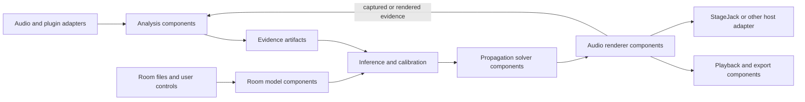

# Earnest engine architecture

## The engine is the host; analysis is one component

Earnest started as an analysis tool. The expanded engine treats analysis as one producer of acoustic evidence inside a larger host. The host can accept observations from sample audio, plugin reports, room files, or future device adapters; reason over those observations; construct an editable acoustic scene; solve it; render audio; and send the result to a file, playback device, plugin, or StageJack adapter.

The CLI selects and configures components. It does not own the equations or DSP. A desktop app, StageJack, or another host should be able to call the same engine components through the same artifact contracts.

## Component flow

Batch components declare required artifact names, produced artifact names, and a `process(context)` method. Components can also publish `ControlParameter` declarations with range, units, default, meaning, and the room/equation value they control. The engine validates ports, passes versioned `Artifact` values between components, records execution timing, and appends component names to provenance. Components can be registered by another Python package; the current implementation uses explicit registration and has not yet added package discovery or a cross-process plugin protocol.

Live audio uses a separate `RealtimeAudioComponent` contract: prepare the audio format and buffers before streaming, accept control changes outside the callback, process blocks, then close. This separation keeps analysis/room solving out of the callback. A Python component can calculate room states and update controls, while a native renderer handles strict callback timing. No real-time host is implemented yet.

## Shared artifacts

| Artifact | Meaning | Likely producers |
|---|---|---|
| `reverb.sweeps` | Matched dry/wet signal pairs, or a normalized measurement input | WAV adapter, plugin adapter |
| `reverb.observations` | Measured direct path, early taps, decay bands, stereo and modulation evidence | Earnest analysis component, third-party importer |
| `reverb.measurement` | Portable measured response formula with source metadata | Analysis/import components |
| `room.document` | Editable user room configuration and master equation controls | Room editor, import/fit workflow |
| `room.model` | Validated geometry, materials, sources, receivers and controls | Room parser component |
| `room.solution` | Solved path/decay data and model limitations | Propagation solver component |
| `audio.sources` | Frame-by-source signals with sample rate supplied as workflow context | File, test-signal, or live input adapter |
| `room.rendered` | Receiver outputs and analysis data | Renderer component |
| `audio.files` / `audio.playback` | Export and playback results | Output components |

An artifact carries its schema, value, optional source, confidence, notes, and provenance. Measurements remain observations; inferred room properties remain hypotheses. An evidence producer should not silently replace user geometry or claim certainty where the inverse problem is underdetermined.

This is a perception loop, not only a one-way render pipeline: Earnest observes a sample or plugin result, forms hypotheses, compares them with the editable scene and target behavior, solves and renders, then analyzes the result again. Each pass should preserve the prior observations and explain what changed in the model. The first implementation records provenance and candidate character; iterative hypothesis scoring and automatic parameter search remain future components.

## Built-in component set

The first host registers these components:

- `reverb.analyze`: matched sweep pairs to analysis observations and an Earnest measurement formula.
- `acoustic.infer_character`: measured decay, early taps and modulation to candidate acoustic character hypotheses, with evidence and limits attached. Confidence labels are qualitative heuristics, not calibrated probabilities.
- `room.parse`: room JSON to a validated room model.
- `room.fit_measurement`: measured decay to calibrated absorption controls plus retained measurement evidence.
- `room.solve_from_analysis`: acoustic hypotheses to per-band absorption fit, calibrated room document, fit report, and forward room solution in one component.
- `room.solve`: room model to image paths, band decay, diffuse-tail estimate, and diagnostics.
- `room.render`: source frames and room solution to receiver audio.
- `audio.room_probe`: deterministic preview signal for trying a room without an external source.
- `audio.export_receivers`: receiver audio to WAV files.
- `audio.play_default`: optional Windows default-device playback.

The room solver and renderer are currently shoebox/offline components. `earnest detect` reads supported Earnest JSON schemas and common audio headers; `room-solve-from-analysis` composes input detection, acoustic inference, RT60-to-absorption fitting, and the forward solve. The fit adjusts equivalent per-band absorption scales while holding supplied geometry, materials, sources and receivers fixed. It does not solve a unique physical room from audio alone or yet fit early reflections, scattering and spatial metrics into geometry. StageJack is not yet a component; its future integration should consume the shared room solution/render stream and expose its controls as parameters to those components, rather than copy room equations into StageJack.

The intended workspace architecture has Earnest as the shared engine, Frankenjack as one control surface and Studio as a wider workspace that may connect to external tools such as local Applio installations through their supported interfaces. These connections and a common live plugin protocol are future work. The current Frankenjack adapter compiles a selected room and restarts its bridge for room-shape changes; it is not a seamless shared real-time graph. Some live mixing and EQ are implemented in its native host.

## Workflow examples

The CLI assembles workflows from the same registered components:

- `room-solve`: `room.parse -> room.solve`
- `simulate`: `room.parse -> room.solve -> room.render -> audio.export_receivers`
- `room-preview`: `room.parse -> audio.room_probe -> room.solve -> room.render -> audio.export_receivers -> audio.play_default` (playback is optional)
- `room-fit`: `acoustic.infer_character -> room.fit_measurement`
- `room`: `reverb.analyze -> acoustic.infer_character`

Input file reading and output report/solution packaging still have some CLI-owned steps. Moving those behind adapters is part of making every I/O route component-driven; the present host is the architectural seam, not the finished plugin system.

## Extension contract

An extension registers a batch component with a unique name, tuples of required and provided artifact names, and a `process(ComponentContext)` method that returns exactly the declared outputs. A live component follows the real-time contract and declares sample rate, channel layout, latency behavior, and control updates. A StageJack-facing adapter could accept StageJack's source blocks while applying the room response solved by Earnest, or send Earnest-rendered blocks to a StageJack output route. Its controls must say whether they change room physics, the rendered effect, or final wet/dry output.

The next design work is to formalize spatial observations and confidence/uncertainty, support arbitrary room geometry and measured IR constraints, then choose the real-time audio boundary. Python remains suitable for the analysis, inference, and offline solver components. A native real-time renderer may be a separate component if measured timing shows Python cannot meet the callback deadline; that does not require moving the acoustic reasoning out of the engine.
